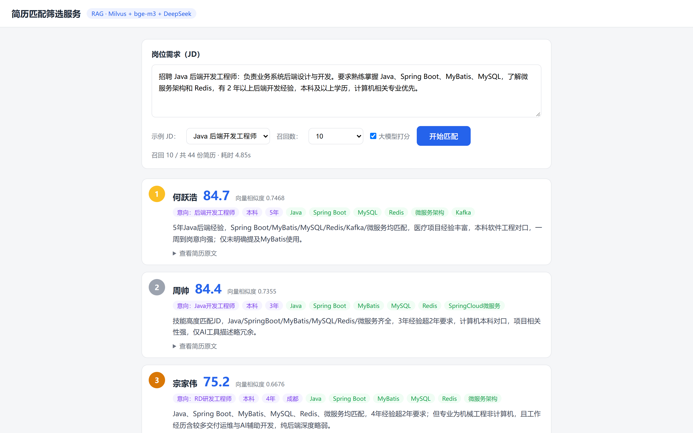

# 简历匹配筛选服务（Resume Match）

基于 53 份简历 PDF 数据构建的「简历 ↔ JD 双向评分」服务：
输入岗位 JD → 向量召回候选简历 → 大模型逐份打分并给出理由 → 按综合分排序返回。



---

## 一、项目目录架构

```
resume-match/
├── config.py                    # 全局配置（支持环境变量覆盖）：Milvus/Ollama/DeepSeek、召回数、融合权重
├── requirements.txt             # Python 依赖
├── Dockerfile                   # 应用镜像（python:3.11-slim 多阶段构建）
├── docker-compose.yml           # 容器编排（app + host.docker.internal 访问宿主机 Milvus/Ollama）
├── .dockerignore / .gitignore
├── README.md                    # 本文档
├── docs/
│   └── demo.png                 # 运行效果截图
├── data/
│   ├── resumes.jsonl            # 结构化简历库（44 条，DeepSeek 抽取产物）
│   ├── sample_jds.json          # 内置示例 JD（5 条）
│   ├── txt_output/              # 简历纯文本（原始数据，不入库，见下文「数据准备」）
│   ├── .parse_cache/            # DeepSeek 抽取缓存（可中断续跑，不入库）
│   └── .embed_cache/            # 向量化批次缓存（不入库）
├── scripts/
│   ├── extract.py               # txt → DeepSeek 结构化 → resumes.jsonl
│   └── build_index.py           # resumes.jsonl → bge-m3 向量化 → Milvus
└── app/
    ├── __init__.py
    ├── main.py                  # FastAPI：/api/health /api/match /api/examples
    ├── matcher.py               # 匹配核心：embed_query / recall / score_resume / match
    └── static/
        └── index.html           # 前端页面
```

---

## 二、实现方案

### 1. 整体数据流

```
53 份简历 PDF
   │  （前置步骤，已在源数据目录完成）文本层解析 + OCR
   ▼
txt_output/*.txt（53 份纯文本，其中 9 份为空文件）
   │  extract.py：DeepSeek 结构化抽取（姓名/学历/技能/意向/经历/项目…）
   ▼
resumes.jsonl（44 条有效简历）
   │  build_index.py：bge-m3 向量化 embed_text 摘要
   ▼
Milvus collection "resume"
   │
   ▼  ── 运行时 ──
用户输入 JD ──> bge-m3 向量化 ──> Milvus 召回 top-N
        │                              │
        │                     候选简历（含原文）
        ▼                              ▼
   DeepSeek 打分（0-100 + 理由 + 匹配技能）◄── 逐份并发
        │
        ▼
   融合排序：final = 0.75×LLM分 + 0.25×向量相似度×100
        │
        ▼
   返回排名列表（姓名/分数/理由/匹配技能/学历/年限/意向）
```

### 2. 技术选型

| 环节 | 选型 | 说明 |
|------|------|------|
| 数据源 | 53 份简历 PDF → txt | 文本层解析 + OCR（前置已完成），9 份空文件被跳过 |
| 结构化抽取 | DeepSeek `deepseek-chat`（云端） | 姓名/学历/技能/意向/经历/项目 → JSON，缓存支持中断续跑 |
| 向量库 | Milvus 2.6.1（standalone） | collection `resume`，IVF_FLAT / COSINE / nlist=16 |
| Embedding | Ollama `bge-m3`（本地） | 1024 维，向量化**结构化摘要 embed_text**（避开 OCR 噪声） |
| 打分模型 | DeepSeek `deepseek-chat`（云端） | 逐份输出 JSON：分数 + 理由 + 匹配技能，temperature=0.1 |
| 后端 | FastAPI + uvicorn | `/api/match` 接口 + 静态页面 |
| 前端 | 原生 HTML + fetch | JD 输入 + 示例下拉 + 排名卡片列表 |
| 部署 | Docker + docker-compose | 应用容器化，宿主机 Milvus/Ollama |

### 3. 关键设计

- **向量化用摘要而非原文**：简历原文含 OCR 错字/编码残留/标签拆行，直接 embed 会稀释语义；改为向量化由结构化字段拼接的 `embed_text`（求职意向/学历/年限/技能/经历/项目），原文仍以标量字段入库供 LLM 打分与前端查看。
- **打分 JSON 稳定解析**：模型输出经「完整 json.loads → 正则提取 JSON 块 → 正则捞 score 数字 → 向量分兜底」四级解析，任何输出格式都能拿到结果。
- **融合排序**：`final = 0.75×LLM分 + 0.25×向量相似度×100`，LLM 为主、向量做 tie-breaker，权重在 config.py 可调。
- **耗时优化**：只对召回 top-N 打分（不打全量）+ 3 路并发 + 单份超时降级 + 同一 JD 结果内存缓存。
- **快速模式**：勾掉「大模型打分」即仅按向量相似度排序，秒级出结果。

### 4. 数据说明

- 原始数据：53 份简历 PDF（测试数据），文本层解析后 44 份有效、9 份为空文件。
- `data/resumes.jsonl` 含真实姓名/电话等个人信息，**仅用于作业演示**，请勿用于其他用途。

---

## 三、环境依赖

| 依赖 | 说明 |
|------|------|
| Milvus 2.6.1 | 端口 19530，本机 standalone |
| Ollama | 端口 11434，需已 pull `bge-m3` |
| DeepSeek API Key | 打分与结构化抽取用（云端） |
| Docker + docker-compose | 容器化部署 |

---

## 四、部署与使用

### 方式 A：Docker 部署（推荐）

```bash
cd resume-match
# .env 中需包含 DEEPSEEK_API_KEY=sk-xxx（compose 自动注入容器）
docker compose up -d --build
```

启动后访问 **http://127.0.0.1:8001**。

> 前置：本机已运行 Milvus（19530）且已建好 `resume` collection（见下方数据准备）。

### 方式 B：本地直接运行

```bash
pip install -r requirements.txt
uvicorn app.main:app --host 127.0.0.1 --port 8000
```

### 数据准备（首次，一次性）

```bash
# 1. 将简历纯文本放入 data/txt_output/（53 份 .txt）
# 2. DeepSeek 结构化抽取（--limit 0 全量，缓存支持中断续跑）
python -u scripts/extract.py --limit 0
# 3. 向量化写入 Milvus
python -u scripts/build_index.py --limit 0
# 如需重建：python -u scripts/build_index.py --limit 0 --drop
```

---

## 五、怎么看前端

1. **启动后**，浏览器打开 **http://127.0.0.1:8001**（Docker）或 **http://127.0.0.1:8000**（本地）。
2. 页面上方是 **JD 输入区**：
   - 直接在文本框粘贴岗位描述；
   - 或在「示例 JD」下拉框选一个内置岗位（Java 后端 / Linux 运维 / 软件测试 / 前端 / Python 开发）；
   - 可调整「召回数」（5/10/20/44 全量）；
   - 「大模型打分」勾选框：勾上 = 向量召回 + LLM 打分（约 3~5 秒）；取消 = 仅向量排序（秒级，用于快速初筛）。
3. 点 **「开始匹配」**，下方按综合分降序展示候选卡片，每张卡片包含：
   - **排名徽章**（前三名金银铜）+ **候选人姓名** + **综合分（大号数字）** + 向量相似度；
   - 标签行：求职意向 / 学历 / 工作年限 / 城市 / 匹配技能（绿色标签）；
   - **匹配理由**：大模型生成的评分依据（如「缺 Kubernetes」「意向不符」等具体分析）；
   - 「查看简历原文」：展开可读完整简历文本。
4. 输入区下方状态栏显示「召回 N / 共 44 份简历 · 耗时 X 秒」。
5. 接口自测（可选）：
   - `GET http://127.0.0.1:8001/api/health` → 健康检查
   - `POST /api/match`，body `{"jd": "...", "top_n": 10, "use_llm": true}`

---

## 六、API 说明

| 方法 | 路径 | 说明 |
|------|------|------|
| GET | `/` | 前端页面 |
| GET | `/api/health` | `{status, collection_ready, resume_count}` |
| GET | `/api/examples` | 内置示例 JD 列表 |
| POST | `/api/match` | 入参 `{jd, top_n=10, use_llm=true}`，返回排名结果 |

`/api/match` 响应结构：

```json
{
  "jd": "……",
  "total": 44,
  "recalled": 10,
  "elapsed": 4.85,
  "results": [
    {
      "rank": 1,
      "id": 3,
      "name": "赖永宏",
      "score": 85.0,
      "llm_score": 85,
      "vec_similarity": 0.7589,
      "reason": "本科计算机专业，8年运维经验……",
      "matched_skills": ["Linux", "Docker", "K8s"],
      "degree": "本科", "work_years": "8年", "city": "广州", "intent": "运维工程师",
      "school": "湘潭大学", "major": "计算机科学与技术",
      "raw_text": "……简历原文……"
    }
  ]
}
```

---

## 七、关键配置（`config.py`，支持环境变量覆盖）

| 配置项 | 环境变量 | 默认值 | 说明 |
|--------|----------|--------|------|
| `MILVUS_HOST` / `MILVUS_PORT` | `MILVUS_HOST` / `MILVUS_PORT` | 127.0.0.1 / 19530 | Milvus 地址 |
| `COLLECTION_NAME` | `COLLECTION_NAME` | `resume` | collection 名 |
| `OLLAMA_BASE_URL` | `OLLAMA_BASE_URL` | http://127.0.0.1:11434 | Ollama（embedding 用） |
| `EMBED_MODEL` | `EMBED_MODEL` | `bge-m3:latest` | embedding 模型 |
| `DEEPSEEK_API_KEY` | `DEEPSEEK_API_KEY` | （.env） | DeepSeek 云端 key（抽取+打分） |
| `DEEPSEEK_MODEL` | `DEEPSEEK_MODEL` | `deepseek-chat` | 打分/抽取模型 |
| `TOP_N` | — | 10 | 默认召回数 |
| `LLM_WEIGHT` / `VEC_WEIGHT` | — | 0.75 / 0.25 | 融合权重 |
| `SCORE_WORKERS` | — | 3 | 并发打分线程数 |
